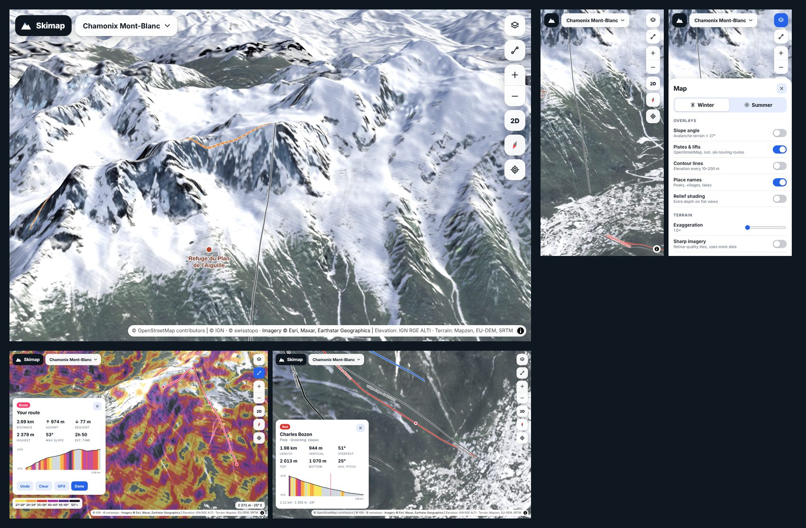

# Skimap

A free 3D ski and ski-touring map in the spirit of FATMAP and Skida: high-resolution aerial imagery
on 3D terrain, turned into a winter scene, with slope angles, pistes, lifts and touring routes.
It starts with **Chamonix Mont-Blanc**, **Riksgränsen** and **Hemavan Tärnaby**.



It is a static website with no backend and no API keys. All imagery, elevation and piste data come
from free public sources, and the image processing runs in the visitor's browser, so hosting is free.

## Features

- **3D terrain everywhere.** Pan, zoom, tilt and rotate freely (globe view when zoomed out).
- **Winter mode (default).** High-resolution summer orthophotos are repainted as winter, pixel by
  pixel, from elevation, slope and the photo itself. Snow lies above the snowline and on anything not
  cliff-steep, rock faces stay bare, forest stays dark with frost, lakes freeze, and a low winter sun
  plus a soft north-west light shade the snow so gullies and ridges read. Summer mode shows the raw
  imagery.
- **Best available imagery per tile:** IGN France BD ORTHO (20 cm), swisstopo SWISSIMAGE (10 cm),
  optionally Lantmäteriet for Sweden, then Esri World Imagery. Gaps in one source are filled from the
  next. Beyond a source's highest zoom its tiles are upscaled, so you can zoom right in on a crux.
- **Slope-angle filter** (one tap, triangle button): avalanche-terrain colour classes (27°, 30°, 35°,
  40°, 45°, 50°+). Drag the two handles on the colour bar to show only a range, say 35–45° for steep
  lines or under 30° for a high-danger day, or use the presets. Add an **aspect filter**: tap the
  compass wedges to show only, say, the north-west to north-east slopes the avalanche bulletin flags.
  Changes apply instantly, because each tile's slope and aspect are cached.
- **Pistes, lifts, ski-touring routes, cross-country trails and huts** from OpenStreetMap, with
  standard difficulty colours.
- **Click anywhere** for elevation, slope, aspect and a link to the avalanche forecast.
- **Click a piste or lift** for its length, vertical, steepest pitch and an elevation profile coloured
  by steepness. Hover the profile to see the spot on the map.
- **Route planner:** click out a skin track or descent and get distance, ascent and descent, high
  point, steepest pitch, an estimated touring time (DAV/SAC rule) and a slope-coloured profile.
  Export it as GPX for your watch.
- Contour lines, place and peak names, relief shading, terrain exaggeration and a "sharp imagery"
  (retina) mode. Works on phones.

> Slope angles come from elevation models and can miss small terrain features. Use this map for
> planning and inspiration, not as your only safety tool. Always check the avalanche forecast.

## Running it

```bash
npm install
npm run dev          # http://localhost:5173
npm run build        # static site in dist/
npm run fetch-osm    # optional: pre-bake pistes & lifts into public/data/osm (else fetched live)
```

## Hosting (free)

`.github/workflows/deploy.yml` builds the site, refreshes piste data weekly and publishes to
**GitHub Pages** (free for public repositories). To turn it on, go to **Settings → Pages → Build and
deployment → Source: GitHub Actions** and push to `main` (or run the workflow from the Actions tab).
With the secrets `LANTMATERIET_USER` / `LANTMATERIET_PASSWORD` set, it also builds 1 m elevation
for the Swedish areas (see [DATA.md](DATA.md)). Any static host works too (Cloudflare Pages, Netlify): build command
`npm run build`, output folder `dist`.

## How it works

```
MapLibre GL JS 6 (globe + 3D terrain)
 ├─ ski-imagery://z/x/y   ┐ custom tile protocols, computed in Web Workers (src/tile-worker.ts)
 ├─ ski-slope://z/x/y     ┘ using the best elevation model per tile (IGN LiDAR 1 m in France)
 ├─ 3D mesh               Mapzen terrain tiles, straight from AWS
 ├─ contours              maplibre-contour (isolines from the DEM, in a worker)
 ├─ OpenStreetMap         pistes/lifts/huts per z11 cell: pre-baked JSON → Overpass API → Cache Storage
 └─ OpenFreeMap           place, peak and lake names
```

| File | What it does |
| --- | --- |
| `src/config.ts` | Imagery providers and elevation layers, best first |
| `src/regions.ts` | Regions: area, start camera, snowline, avalanche bulletin |
| `src/dem.ts` | Elevation engine: fetches/decodes DEM tiles (PNG, IGN LiDAR float grids, PMTiles), merges layers, reads each at its true resolution and upsamples bicubically across tile borders, computes slope, aspect and shading |
| `src/imagery.ts` | Orthophoto mosaic and the winter filter |
| `src/slope.ts` | Slope-class tiles |
| `src/osm.ts` | OpenStreetMap loader and conversion |
| `src/style.ts` | Map style: layers, colours, line widths |
| `src/main.ts` | UI: region picker, layers panel, info cards, route planner |
| `scripts/build-dem.py` | Turns GeoTIFF elevation data (e.g. Lantmäteriet 1 m) into a PMTiles layer |
| `scripts/fetch-lantmateriet.py` | Downloads Lantmäteriet's 1 m terrain model for an area (STAC-hojd API) |
| `scripts/fetch-osm.ts` | Pre-bakes OpenStreetMap data for all regions |

### Adding a region

Add an entry to `REGIONS` in `src/regions.ts` (bounding box, start camera, snowline, avalanche
bulletin link). Imagery and elevation work worldwide; the regions only decide the menu, the
pre-baked piste data and the local snowline.

## Data

See [DATA.md](DATA.md) for every source, its licence, its resolution and how to plug in better data.
